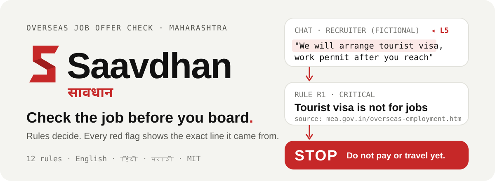
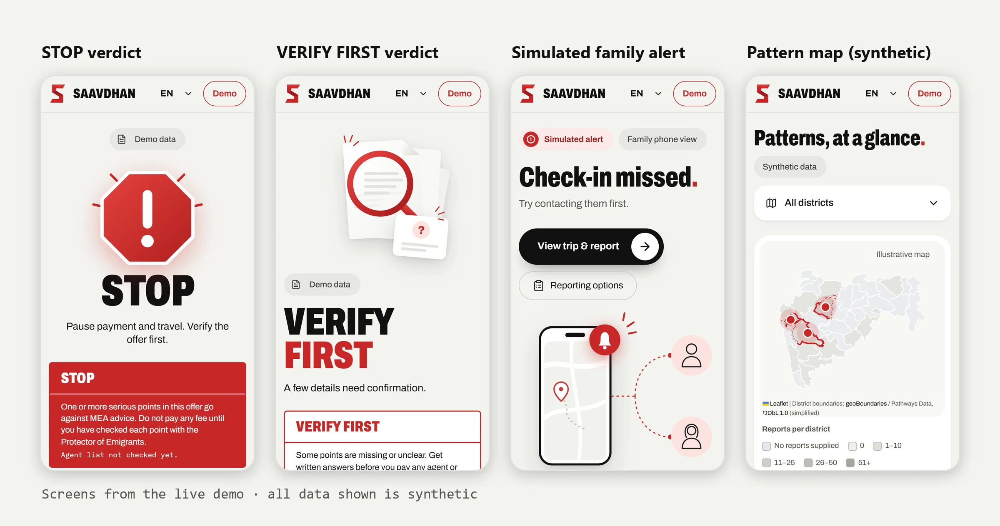
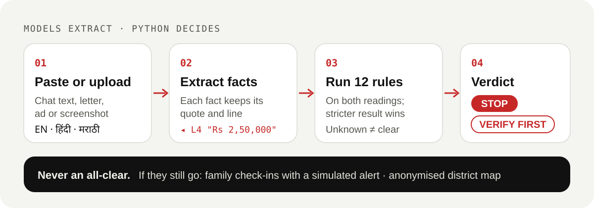

<p align="center">
  
</p>

<p align="center">
  <b><a href="https://saavdhan.onrender.com">Live demo</a></b> ·
  <a href="docs/ARCHITECTURE.md">Architecture</a> ·
  <a href="docs/RULES.md">Rules and sources</a> ·
  <a href="docs/PRIVACY.md">Privacy</a> ·
  <a href="#quick-start-windows-powershell">Run it locally</a>
</p>

**Saavdhan** (सावधान, "alert") checks an overseas job offer against India's emigration rules before a young person pays an agent or travels. If they still go, it runs a family check-in net. For colleges and cyber police it shows an anonymised map of reported offers.

Prototype for Hack for Social Cause 2027, theme 8 (Digital Safety & Cyber Fraud Awareness), framed for Maharashtra. All demo data is synthetic. The live demo runs on free hosting and may take a minute to wake.

<p align="center">
  
</p>

More screens, including Hindi and Marathi: [docs/screenshots](docs/screenshots/README.md).

## What it does

- **M1, offer check.** Paste WhatsApp text or upload an offer letter, job ad or screenshot (PDF, TXT, PNG, JPG, WEBP, TIFF; up to 10 files), in English, Hindi or Marathi. Saavdhan extracts the facts, runs 12 rules and shows a verdict. Every point carries the quoted line and the rule source. See [docs/RULES.md](docs/RULES.md).
- **M2, check-in net.** The traveller picks up to two contacts (aliases only), a travel plan and a check-in interval. A missed check-in produces a **simulated** alert with the report packet. Nothing is sent to anyone.
- **M3, pattern map.** A login-only view of anonymised reports across Maharashtra's 36 districts. Phone numbers are salted and hashed before aggregation, so the same agent number shows up across districts without being revealed. The current data is synthetic.

## How it decides

<p align="center">
  
</p>

- **Models extract, Python decides.** An optional LLM only reads the offer and must quote its evidence verbatim. The deterministic extractor always runs. Rules run on both extractions and the stricter result per rule is kept. An LLM never sets a verdict.
- **Verdict levels:**
  - `STOP`: any critical rule hit.
  - `VERIFY_FIRST`: any high-severity hit, three or more unknowns on the key rules, or no valid recruiter-list date.
  - `NO_RED_FLAGS_FOUND`: none of the above. The only text shown is: "No red flags found. Confirm with the Protector of Emigrants before paying anything."
- Unknown is never treated as clear. Every verdict shows the date of the MEA recruiter list it was checked against.
- Saavdhan never gives an all-clear for an offer and never calls a named person or agency a fraud. It states verifiable facts, such as "not found on MEA's active recruiting agent list dated X".

## Why this exists

Fake overseas job offers move young people into scam compounds and forced labour. The pattern is consistent: a data-entry or IT job in Thailand, high pay, a fee of several lakh paid by UPI, a tourist visa, and contact only through WhatsApp. The MEA rules that would expose these offers already exist. Nobody checks them before the money moves.

<details>
<summary><b>Sources</b> (summarised as reported by the named outlets; not independently re-verified in this repository)</summary>

- As reported by Scroll: Maharashtra police rescued over 60 Indians from cyber scam centres in Myanmar; they had been lured through social media and sent to Thailand on tourist visas. https://scroll.in/latest/1081252/over-60-indians-rescued-from-cyber-scam-centres-in-myanmar-five-agents-arrested
- As reported by EastMojo, an MEA advisory warned about fake Thailand data-entry jobs that led into Myanmar. https://www.eastmojo.com/national/2022/09/25/verify-credentials-of-foreign-employers-mea-advisory-following-fake-job-offers-in-myanmar/
- As reported by Deccan Chronicle, MEA guidance says: a work visa, not a tourist visa, is needed for work; the contract is signed by employer, agent and worker; agents must be registered on eMigrate; and the agent fee is capped at Rs 30,000 plus 18% GST. https://deccanchronicle.com/nation/in-other-news/141223/centre-cautions-foreign-job-seekers.html
- As reported by Greater Kashmir, unregistered agents overcharge Rs 2 to 5 lakh, mostly through WhatsApp. https://greaterkashmir.com/national-2/govt-advisory-cautions-against-fraudulent-overseas-job-offers
- As reported by ThePrint, Karnataka Cyber Command in July 2026 flagged IT, customer-support and data-entry roles in Thailand, Myanmar, Laos and Cambodia. https://theprint.in/india/two-karnataka-youth-rescued-from-chinese-operated-scam-compound-in-myanmar/2993049/
- As reported by Deccan Herald, a youth from Belagavi paid Rs 2.5 lakh for Singapore data-entry jobs in January 2026 and ended up in Cambodia. https://www.deccanherald.com/amp/story/india%2Fkarnataka%2F3-belagavi-youth-forced-into-cyber-slavery-in-cambodia-rescued-3862439
- MEA publishes the overseas employment guidance and the active recruiting agent (RA) lists: https://www.mea.gov.in/overseas-employment.htm

</details>

## Quick start (Windows PowerShell)

Requires Python 3.12 and Node.js 22.

```powershell
python -m venv .venv
.\.venv\Scripts\python -m pip install -r requirements.lock.txt

cd frontend
npm ci
npm run build
cd ..

.\.venv\Scripts\python -m uvicorn backend.main:app --reload
```

Open http://localhost:8000 and choose a demo offer.

### Configuration and optional features

- **Environment variables.** Copy `.env.example` to `.env` and edit it. `.env` is gitignored; never commit it.
- **OCR for image offers.** Install Tesseract. For Hindi and Marathi screenshots add the `hin` and `mar` tessdata, then set `SAAVDHAN_OCR_LANGS=eng+hin+mar`. Set `SAAVDHAN_OCR_ENABLED=true` and `TESSERACT_CMD` if Tesseract is not on PATH.
- **LLM extraction (off by default in the example configuration).** For OpenRouter, set `SAAVDHAN_ENABLE_LLM=true`, `SAAVDHAN_LLM_BASE_URL=https://openrouter.ai/api/v1`, `SAAVDHAN_OPENAI_MODEL=nvidia/nemotron-3-ultra-550b-a55b:free` and `OPENAI_API_KEY` in your ignored local `.env`. Offer text is then sent to that gateway; use synthetic demo text only. See [docs/PRIVACY.md](docs/PRIVACY.md). A live synthetic probe on 2026-10-26 returned four expected facts with validated quotes; broader model evaluation and hosted configuration remain unverified. Restart an existing backend after changing configuration.
- **Pattern map (M3).** Run `.\.venv\Scripts\python scripts\seed_demo_officer.py` once. It creates a local demo officer account, and the password is written to `.env` as `SAAVDHAN_DEMO_OFFICER_PASSWORD`. Local use only.

## Tests and evaluation

```powershell
.\.venv\Scripts\python -m pytest tests -q
.\.venv\Scripts\python eval\run_eval.py
```

- 227 tests in `tests/`, including labelled offer PDFs in English, Hindi and Marathi (`tests/fixtures/offers/`).
- CI (`.github/workflows/validate.yml`) runs pytest, the frontend build, the i18n check and a grep that fails on the word "safe" in app code.

Evaluation headline (from [eval/REPORT.md](eval/REPORT.md)): on 40 synthetic offers, verdict accuracy 1.000, macro rule F1 0.948, field accuracy 0.880, median analysis time 2.3 ms. **Caveat:** the set is synthetic and was written for this project. The fallback extractor was tuned on the same set after a first run that scored 27/40, so these numbers are optimistic. A held-out set is needed for an honest estimate. The eval also stubs the recruiter-list lookup; it does not use the real MEA list.

## Architecture and deployment

- [docs/ARCHITECTURE.md](docs/ARCHITECTURE.md): components, data flow diagram, trust boundaries, storage and security controls.
- [docs/DEPLOY.md](docs/DEPLOY.md): one Docker image (FastAPI serves the API and the built React app), deployed on Render from [`render.yaml`](render.yaml). Tesseract with English, Hindi and Marathi is included.
- [docs/CONTRACTS.md](docs/CONTRACTS.md): the field contracts shared by the extractors, rules and UI.

## Limits

- **Family alerts are simulated.** No SMS, WhatsApp or call is sent. The demo clock can be moved forward to show a missed check-in.
- **Pattern map data is synthetic.** It is not a record of real reports.
- **Recruiter list not loaded.** The MEA RA list is not parsed in this build. R2 shows "Agent list not checked yet", and because the list date is missing, the app cannot show `NO_RED_FLAGS_FOUND`. Offers without a critical or high hit show `VERIFY_FIRST`.
- **Fee cap to verify.** The Rs 30,000 + 18% GST figure is as reported by MEA advice. Check the current official figure before use.
- **Not legal advice.** It can be wrong. Ask the Protector of Emigrants or a lawyer for legal questions.
- **No automated reporting.** Saavdhan never reports anyone to an authority. The user decides who to tell.
- **Language.** Hindi and Marathi copy is pending native review (see [frontend/src/i18n/REVIEW.md](frontend/src/i18n/REVIEW.md)).
- **Single-user demo limits.** Production needs per-client limits and a proxy configuration review; see the known gaps in [docs/ARCHITECTURE.md](docs/ARCHITECTURE.md).

## Hack for Social Cause 2027

- Theme 8 (Digital Safety & Cyber Fraud Awareness), sub-theme 8a: a scam detection and reporting assistant for job-offer scams. State framing: Maharashtra.
- UN SDGs: 8.7 and 8.8 (forced labour, migrant workers' rights), 10.7 (safe, orderly migration), 16.2 (ending exploitation and trafficking) and 16.10 (public access to information).
- Submission components and where they live:
  - Deck and speaker notes: `docs/DECK-OUTLINE.md` (the final PDF is built from it on the official template).
  - Demo video script: `docs/DEMO-SCRIPT.md`.
  - Architecture and data flow: `docs/ARCHITECTURE.md`.
  - Rules with sources: `docs/RULES.md`.
  - Privacy and DPDP notes: `docs/PRIVACY.md`.
  - Sample data and test cases: `eval/offers/` (synthetic), `tests/`, `eval/REPORT.md`.
  - Licence: `LICENSE` (MIT). Third-party licences: `docs/THIRD-PARTY.md`.
  - AI disclosure: `AI_USAGE.md`.

## Team

- Sandesh Prakash Dawkhar, team lead
- Anshuman Singh Rajpurohit
- Soyam Meghraj Kayasth

## Provenance and credits

Saavdhan reuses the evidence engine (ingest, OCR, quote-validated extraction, audit log, ZIP packet) from **Bakaya**, an open-source project by the same author: https://github.com/Sandesh13fr/Bakaya. The reused parts are listed in [docs/REUSE-MAP.md](docs/REUSE-MAP.md). The rest (offer schema, rules, verdict, check-in net, pattern map, UI) was written for this project.

Map boundaries are from geoBoundaries (ODbL) and base tiles are from OpenStreetMap contributors (ODbL); see [docs/THIRD-PARTY.md](docs/THIRD-PARTY.md).

## AI usage

This project was built with AI coding tools under human direction and review. See [AI_USAGE.md](AI_USAGE.md) for the tools, the work each one did and the estimated share of AI-produced code.

## Licence

MIT. See [LICENSE](LICENSE).
