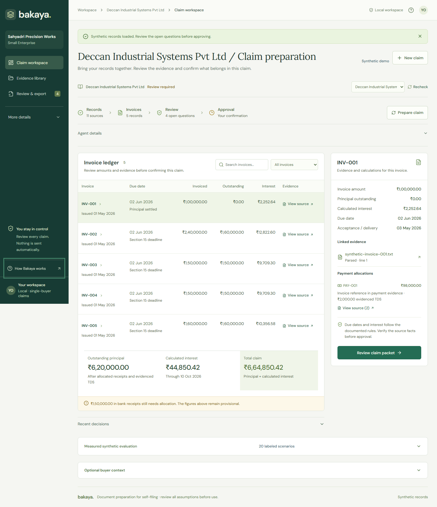
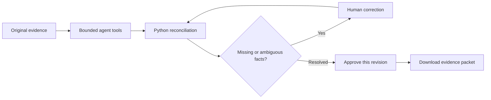

# Bakaya

**Turn invoice, payment and TDS evidence into a claim packet a person can review.**

Bakaya helps Indian micro and small suppliers prepare delayed-payment documentation. A bounded agent organizes evidence and asks for missing decisions; Python checks the money; a person approves the current revision before export. Nothing is sent or filed automatically.

[Try the authenticated synthetic demo](https://bakayaai-sandesh.vercel.app) · [Input guide](docs/INPUTS.md) · [Verification evidence](docs/JUDGING-EVIDENCE.md)



*Captured local synthetic workspace. Fictional records and provisional totals illustrate the workflow; this is not a real claim or a current production screenshot.*

[Watch the recorded local lifecycle](docs/assets/agent-lifecycle.webm) · [Inspect its evidence](docs/evidence/agent-lifecycle.json) · [Full Neatlogs lifecycle and paired replays](docs/evidence/PAIRED-AGENT-REPLAY.md)

The recording follows one synthetic goal and run ID through ten checkpoints: reviewer pause, scripted human corrections (revision 1→2), approval pause, packet completion and ZIP download. It uses zero paid calls. It is a deterministic local workflow, separate from the live model and injected-failure tests; it is not a Neatlogs trace or the final narrated three-minute presentation.

## From evidence to reviewed export



- **Follow the source:** proposed facts retain quotes, file hashes and page/line references. Hashes verify stored bytes, not document authenticity.
- **Keep calculations separate:** Decimal arithmetic reconciles invoices, cash and evidenced TDS; unresolved allocations block approval.
- **Resume safely:** saved steps retain progress and failures. Corrections invalidate earlier approval.
- **Control the release:** authenticated review and tenant-scoped access protect cases, evidence and exports.

## What is verified

| Area | Evidence and boundary |
| --- | --- |
| Application | 99 Python tests passed on 11 October; frontend build; local desktop/mobile approval and ZIP export; tablet overflow checks. See dated [evidence](docs/JUDGING-EVIDENCE.md). |
| Agent | Live synthetic extraction/planning and separate injected local recovery passed. The 20-fixture comparison is a deliberately flawed baseline (14/20) against the corrected matcher (20/20), not production accuracy. |
| Neatlogs | Two controlled full-lifecycle traces each contain 27 verified spans, review/approval pauses, export and simulated recovery. Actual revisions show redundant packet writes 1→0 with identical totals. Zero model calls in this comparison; the earlier model trace is separate. |
| Entire | Saved/pushed checkpoints and linked-file attribution verified. Git-assisted rollback passed in an isolated clone; native session resume did not restore code. |
| cfo.ai | Editable pricing, delivery-cost, monthly revenue and conditional runway model read back with zero formula errors. Owner-provided cash ₹30,000 and fixed costs ₹20,000/month give 1.5 months runway at zero assumed sales; illustrative stress demand gives 2.83 months. Read-only judge sharing enabled; public CSV fallback available. [Model status](docs/market/cfo-integration.md). |
| Crustdata | Administrator-only consented, cached buyer enrichment; local 500-credit ceiling. Company data does not establish legal identity or eligibility. |
| Authentication | Server-provisioned roles, tenant authorization, revocable sessions, CSRF and login throttling tested. No self-signup, MFA or email recovery. |
| Deployment/backups | Authenticated synthetic Vercel/AWS deployment and HTTPS checks recorded. Encrypted daily backups active; one downloaded off-host archive restored. Automated off-host transfer remains pending. |
| OCR | Clean synthetic PNG/scanned-PDF checks passed. A difficult public CORD receipt recovered 0/5 expected amounts; manual review remains essential. |

## Run locally

Windows PowerShell, Python 3.12+ and Node.js 22+:

```powershell
.\scripts\start.ps1
```

Open <http://127.0.0.1:8000>. The script installs dependencies, builds React and serves FastAPI. The local synthetic demo needs no API key. Choose **Explore a demo**, or upload the fictional CSVs in `samples/`; see the [input guide](docs/INPUTS.md).

Live model extraction/planning needs an OpenAI-compatible key. Optional buyer enrichment uses Crustdata. Keep credentials and private evidence out of Git; configure from [`.env.example`](.env.example) and follow [manual steps](docs/MANUAL-STEPS.md).

<details>
<summary>Development and checks</summary>

Run the backend:

```powershell
.\.venv\Scripts\python.exe -m uvicorn backend.main:app --host 127.0.0.1 --port 8000 --reload
```

Run the interface in another terminal:

```powershell
cd frontend
npm.cmd ci
npm.cmd run dev
```

Check changes:

```powershell
.\.venv\Scripts\python.exe -m pytest tests -q
cd frontend
npm.cmd run build
```

</details>

## Deployment and real-document limits

The demo at [bakayaai-sandesh.vercel.app](https://bakayaai-sandesh.vercel.app) uses a public shared reviewer account and synthetic records only; the login page shows its demonstration credentials. AWS default-encrypted provisioning failed; the owner explicitly approved unencrypted EBS for this temporary synthetic demonstration. **Do not upload real financial records.** Read the [deployment evidence and operating limits](docs/PRODUCTION.md#live-synthetic-deployment--11-october-2026) and [AWS usage rules](docs/AWS-USAGE.md).

Docker build/run, tenant rejection, secure-cookie/CSRF checks, OCR uploads and encrypted backup/restore were tested locally. Deployed visual QA, automated off-host backups, retention/deletion, monitoring, malware controls, privacy policy and independent security review still need completion before sensitive customer use.

No customer or qualified professional has validated a real claim. Eligibility, acceptance/registration dates, TDS treatment, historical RBI rates and portal requirements need independent confirmation. Invoice dates alone do not establish eligibility; current rates must not be applied retroactively. The [production guide](docs/PRODUCTION.md) contains the consented real-document and professional validation protocol.

## Project and submission material

Python/FastAPI/Pydantic/SQLite with Decimal calculations; React/TypeScript/Vite with Radix dialogs; local Tesseract OCR. Dependency lockfiles support reproducible installs.

[Release package](docs/RELEASE-PACKAGE.md) · [Milestones](docs/HACKATHON-MILESTONES.md) · [Tracing](docs/TRACING.md) · [Market research and pricing hypotheses](docs/market/README.md)

The public repository is engineering evidence, not proof of demand or recovery outcomes. Narrated demo, public progress post and submission remain manual. Original supplied material is preserved in [the PRD](docs/original-prd.md) and [message](docs/original-message.txt).
