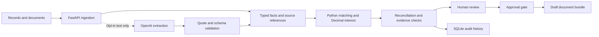

# Architecture and trust boundaries

The application is a single local Python service with a built React interface and SQLite case storage. The browser collects records and review decisions. The Python service ingests documents, validates typed records, computes allocations and interest, stores audit events and enforces approval before export.

## Arithmetic and legal rules

Amounts use Decimal. Rate periods carry source references; the engine rejects missing or overlapping coverage. Monthly rests, intramonth day-count and payment allocation conventions are disclosed for professional review. Money is rounded for output rather than at each accrual step. Legal rules and arithmetic conventions are separate: a computationally correct figure can still depend on disputed acceptance, registration, payment appropriation or rate facts.

## Extraction and provenance

Structured CSV/XLSX rows carry line references, PDFs carry page references, and text exports carry line references. Source hashes identify the uploaded bytes; they do not establish authenticity. Source quotes and typed validation constrain optional model extraction but do not guarantee that the model interpreted the source correctly. Document content is untrusted data and cannot approve exports or change system instructions.

## Human review

Unknown facts, unreadable scans, unsubstantiated deductions and ambiguous payments remain visible. Human confirmation does not replace missing source evidence. Updates must invalidate earlier approval so exported figures correspond to the reviewed version. Nothing is sent to buyers or submitted to a government portal.

## External services

OpenAI is optional and disabled by default. The supplied sponsor names represent integration targets; local audit events do not constitute neatlogs traces or Entire checkpoints. Paid extraction cost is unknown until real provider usage is recorded. No secret should appear in source, browser responses, exported documents or public audit data.

## Production work remaining

Before public or multi-client deployment, implement authenticated users, tenant isolation, document access permissions, file screening, quotas, reliable jobs for extraction, monitoring, retention/deletion and recovery procedures. Establish the authoritative legal and RBI update process, professionally validate interest conventions, and test on consented real records. SQLite is adequate for the single-reviewer local prototype; production storage and job handling must follow actual workload requirements.
