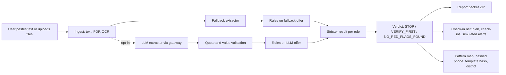

# Architecture

Saavdhan is a FastAPI backend with a Vite + React frontend. It has three parts: the offer check (M1), the check-in net (M2) and the pattern map (M3).

## Components

| Component | Path | Role |
|---|---|---|
| Ingest | `backend/ingest.py` | PDF text, TXT, image OCR (opt-in Tesseract), SourceRef with sha256 and stored name |
| Fallback extractor | `backend/extract_fallback.py` | Deterministic extraction for en, hi, mr and Hinglish text. Always runs |
| LLM extractor (opt-in) | `backend/providers.py` | OpenAI-compatible call. Every field must carry a verbatim quote; sources are attached by the server |
| Pipeline | `backend/agent.py` | Bounded, fixed pipeline: ingest, extract, validate, rules, verdict. No model chooses tools |
| Rules | `backend/rules.py` | 12 rules returning hit, clear or unknown |
| Verdict | `backend/verdict.py` | Pure Python decision from rule hits and the recruiter-list date |
| Check-in net | `backend/safety.py` | Check-in plan, simulated clock, simulated alerts (file name kept from the code) |
| Pattern map | `backend/reports.py`, `frontend/src/features/map/` | Salted HMAC phone hashes, simhash offer templates, district aggregation; synthetic data |
| Packet | `backend/exports.py` | ZIP: summary PDF, facts CSV, rule-check CSV, audit log, check-in itinerary, evidence copies |
| Storage | `backend/storage.py` | SQLite case store with revision compare-and-set; uploads on disk |
| Auth | `backend/auth.py` | Accounts for the pattern map only. scrypt hashes, 8-hour sessions, login throttling |
| API | `backend/main.py` | Routes, security headers, CSRF, rate limit, host checks |
| UI | `frontend/` | Six screens: check offer, result, check-in plan, family, map, limits. Copy in `frontend/src/i18n/` |

## Data flow

Steps in `backend/agent.py`:

1. Ingest creates SourceRef records and sha256 hashes.
2. The fallback extractor always runs and rules run on its output.
3. If the LLM is enabled and succeeds, its fields are validated: each quote must appear in the source, and the server attaches `source_ref`. Rules run on the LLM output too.
4. For each rule, the stricter status wins (hit over unknown over clear; higher severity breaks ties). An LLM can therefore add a red flag but cannot remove one the fallback found.
5. `decide()` returns the verdict. The recruiter-list date is passed in; if it is not a valid date, the verdict cannot be `NO_RED_FLAGS_FOUND`.

Models never write rule results, verdicts or case state.

## Trust boundaries

- **Document text is untrusted.** Pasted or uploaded content can contain instructions. It is treated as data and cannot change prompts, approve exports or trigger actions.
- **LLM output is untrusted.** It is accepted only where a verbatim quote supports it, and it can only raise the strictness of a rule.
- **Python decides.** Rules, verdict and the best-verdict text come from code.
- **Browser to API.** Mutations need a CSRF token. The check-in and offer routes are anonymous; map routes need a login.
- **Reverse proxy.** Client IPs come from proxy headers only when uvicorn runs with `--proxy-headers`. The trusted proxy list is an open item (see Known gaps).
- **Third parties.** The optional LLM gateway receives offer text. OpenStreetMap tiles receive the viewer's IP. See [PRIVACY.md](PRIVACY.md).

## Storage and retention

- SQLite database at `data/saavdhan.sqlite3` (gitignored). Uploads at `data/uploads/` (gitignored).
- Cases belong to a tenant. Anonymous cases are purged after `SAAVDHAN_RETENTION_HOURS` (default 24) and capped at `SAAVDHAN_ANON_CASE_CAP` (default 200) by age and count. The anonymous upload budget is `SAAVDHAN_ANON_UPLOAD_MB` (default 500).
- Production limits: 10 cases and 50 MiB per tenant (`storage.py`).
- Saves use `BEGIN IMMEDIATE` with an expected-revision check, so concurrent edits fail instead of overwriting.
- Each case keeps an audit log, capped at 1000 events.

## Security controls

From the Phase 3 review in [BUILD-STATUS.md](BUILD-STATUS.md):

- LLM output must quote the source; fabricated quotes are rejected. The server attaches provenance.
- Rules run on both extractions; the stricter result wins.
- No best verdict is shown without a real recruiter-list date.
- Limits on pasted text (50,000 characters), lines per file (20,000), upload size (15 MB per file) and file count (10).
- Anonymous retention, eviction and a per-IP rate limit on case creation (`SAAVDHAN_RATE_MAX`, default 30 per 10 minutes).
- Phone numbers are HMAC-SHA256 hashed with `SAAVDHAN_HASH_SALT`. Production refuses to start without a salt of at least 16 characters.
- Demo clock works only on demo cases in production.
- Host allowlist (`TrustedHostMiddleware`), security headers including CSP and frame denial, CSRF on mutations, scrypt password hashes, login throttling, path traversal guard on source downloads.
- Production is fail-closed for account creation (CLI provisioning only).

## Reused from Bakaya and new code

Reused (from [REUSE-MAP.md](REUSE-MAP.md)): ingest and OCR, the SQLite store with revision checks, the bounded pipeline pattern, LLM transport with no automatic retry on 402 or 429, the packet ZIP writer, auth and session handling, middleware and security headers, telemetry no-op shim.

New for Saavdhan: the `Offer` schema and quote-carrying `FieldValue`, `rules.py`, `verdict.py`, the fallback extractor for multilingual offers, the check-in net, the pattern map, the six-screen frontend and the i18n copy. Invoice, interest and TDS code was removed.

## Known gaps

- The MEA recruiter list is not parsed yet. R2 reports "not checked"; the verdict cannot reach `NO_RED_FLAGS_FOUND`.
- The LLM path has not been run live in this build.
- Anonymous visitors share one tenant in production with a 10-case cap. Per-client limits need review before any public deployment.
- `FORWARDED_ALLOW_IPS` should be narrowed to the proxy address.
- Login lockout per account is not implemented; throttling is per email and per IP.
- Hindi and Marathi copy needs native review.
